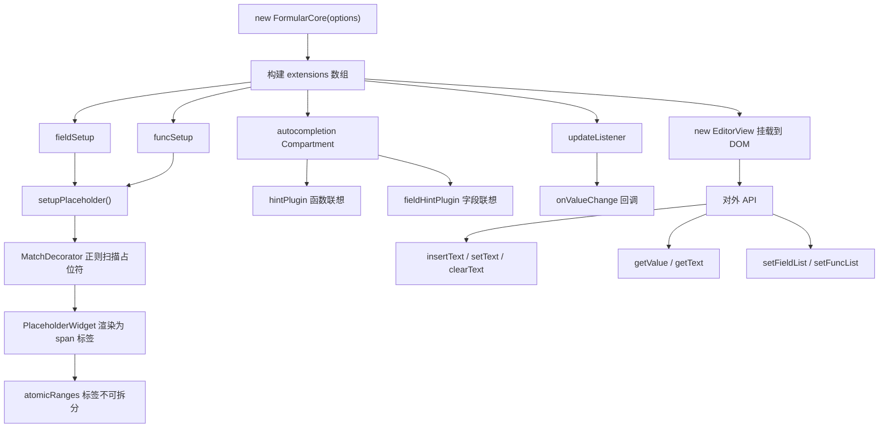

# codeMirror整体流程图

> `core` 包是公式编辑器的输入层，基于 **CodeMirror 6** 封装，负责将结构化占位符渲染为可视化标签，并提供联想补全能力。

---

## 前置：CodeMirror 6 的三个核心概念

理解这三点，读代码才不会懵。

### State 不可变

编辑器所有状态（内容、光标）都存在 `EditorState` 里，**不能直接修改**，只能通过 `dispatch(transaction)` 提交变更，CM6 内部生成新 State。和 Redux 思想一样。

### Extension 是插件系统

所有功能（高亮、联想、快捷键）都是 Extension，创建编辑器时传入数组，CM6 负责组合。

### Decoration 只改显示，不改数据

Decoration 给文本加"皮肤"，底层存储的字符串不变。公式编辑器用的是 `Decoration.replace`——把一段原始文本替换显示成自定义 DOM 元素。

---

## 文件结构

```
core/src/
├── index.ts            # 主入口，FormularCore 类
├── typing.d.ts         # 所有 TypeScript 类型定义
├── utils/index.ts      # 工具函数（voidFn 空函数兜底）
└── plugins/
    ├── placeholder.ts  # 占位符装饰插件（视觉核心）
    ├── hint.ts         # 函数联想插件
    └── fieldHint.ts    # 字段联想插件
```

---

## 第一步：类型定义（`typing.d.ts`）

类型是系统的数据契约，先看清楚数据结构。

### `IFieldData` — 字段数据

```typescript
interface IFieldData {
  value: string | number  // 机器用的 key，如 "user.name"
  label: string           // 人看的名字，如 "用户名"
  type?: string           // 数据类型：'string' | 'number' | 'date' | ...
  fold?: boolean          // 是否是可展开的树节点
  children?: IFieldData[] // 子字段（支持嵌套）
}
```

### `IFuncData` — 函数数据

```typescript
interface IFuncData {
  alias: string      // 显示名，如 "求和"，也是编辑器里的触发词
  name?: string      // 编码名（英文），如 "SUM"
  groupAlias: string // 所属分组，如 "数学函数"
  usage: string      // 用法模板，如 "SUM(num1, num2)"（影响 snippet 生成）
  desc: string       // 说明文字
  example: string    // 示例
}
```

> `usage` 决定函数插入时是否生成 Tab 跳转参数。`SUM(num1, num2)` 会让光标插入后停在 `num1` 上，按 Tab 跳到 `num2`。

### `IPlaceholderOption` — 占位符配置

描述"如何处理一种占位符"的规则对象：

```typescript
interface IPlaceholderOption<T> {
  reg: RegExp                        // 匹配占位符的正则
  className: string                  // 标签的 CSS 类名
  hanlder: (match) => string         // 从匹配结果提取"显示文本"（:: 左边）
  fieldHanlder?: (match) => string   // 提取"值路径"（:: 右边）
  output: (data, parents?) => ...    // 把数据节点转成占位符字符串
}
```

字段和函数各有一套，但结构相同。

### `IFormularCoreOption` — 初始化配置

```typescript
interface IFormularCoreOption {
  $el: HTMLElement            // 编辑器挂载节点
  value?: string              // 初始公式值
  fieldList?: IFieldData[]    // 字段列表（联想 + 插入用）
  funcList?: IFuncData[]      // 函数列表（联想 + 插入用）
  onValueChange?: Function    // 内容变化回调
  fieldMatchConfig?: ...      // 可选，覆盖默认字段占位符规则
  funcMatchConfig?: ...       // 可选，覆盖默认函数占位符规则
  readonly?: boolean          // 只读模式
}
```

---

## 第二步：占位符装饰插件（`placeholder.ts`）

### 核心设计：存储与显示分离

用户看到的：
```
用户名 + " 你好"
```

编辑器实际存储的：
```
${field.用户名::user.name} + " 你好"
```

两者不同。存储的是完整结构化字符串，显示的是通过 `Decoration.replace` 渲染的 `<span>` 标签。

### `PlaceholderWidget` — 标签的 DOM 渲染

```typescript
class PlaceholderWidget extends WidgetType {
  toDOM(): HTMLElement {
    const el = document.createElement('span')
    el.className = this.#className   // 如 "formula-tag--field"
    el.textContent = this.#showText  // 如 "用户名"
    return el
    // 生成: <span class="formula-tag--field">用户名</span>
  }

  // 文本未变则不重新渲染（性能优化）
  eq(other) { return other.#showText === this.#showText }
}
```

### `setupPlaceholder` — 把规则变成 CM6 插件

```
MatchDecorator（扫描文本，按正则找到所有占位符）
    ↓
为每个匹配创建 Decoration.replace（替换显示为 PlaceholderWidget）
    ↓
ViewPlugin（响应编辑器更新，增量刷新装饰）
    ↓
atomicRanges（关键！把标签变成"原子"——光标无法停在内部，只能停在两侧）
```

`atomicRanges` 的效果：用户按 `←` 时整体跳过标签，按 `Backspace` 时整体删除标签，就像操作一个普通字符。

---

## 第三步：`FormularCore` 的构造过程

构造函数核心是组装 CM6 的 `extensions` 数组：

```typescript
const extensions = [
  minimalSetup,         // CM6 基础配置（快捷键、撤销重做等）
  this.fieldSetup,      // 字段占位符插件（getter，执行时初始化 fieldMatchConfig）
  this.funcSetup,       // 函数占位符插件（getter，执行时初始化 funcMatchConfig）
  updateListener,       // 内容变化监听
  autocompletion(...)   // 联想插件（有数据时才加入）
]
```

### `fieldSetup` / `funcSetup` 是 getter

```typescript
// 读取 this.fieldSetup 时，getter 代码立即执行
const extensions = [
  this.fieldSetup,  // ← 此时 fieldMatchConfig 被初始化，并返回 CM6 插件
]
```

getter 内部做了两件事：
1. 用默认规则初始化 `fieldMatchConfig`（支持用户传入覆盖）
2. 调用 `setupPlaceholder()` 返回 CM6 插件

### `fieldMatchConfig.output` 的拼装逻辑

```
点击字段面板：父节点 { label: '用户', value: 'user' }
             当前节点 { label: '姓名', value: 'name' }

output(当前节点, [父节点])：
  labels = ['用户', '姓名']
  values = ['user', 'name']
  → "${field.用户.姓名::user.name}"
```

### `funcMatchConfig.output` 的 snippet 处理

```
输入：{ alias: 'SUM', usage: 'SUM(num1, num2)' }

解析 usage，把参数转成 snippet 格式：
  "SUM(num1, num2)"
    → "(#{num1}, #{num2})"  （suffix）

因为 ${} 和 CM6 snippet 语法冲突，有参数时转义前缀：
  prefix = '$\\{func.'

最终：
  { text: "$\{func.SUM::SUM}(#{num1}, #{num2})", hasParams: true }
```

---

## 第四步：联想插件

### `autoCompleteSetup` — 条件加载

```typescript
// 有 funcList 或 fieldList 才创建联想插件
return [
  funcList.length > 0 ? hintPlugin(options) : null,
  fieldList.length > 0 ? fieldHintPlugin(options) : null,
].filter(Boolean)
```

### `hint.ts` — 函数联想

**触发条件**：输入英文字母、数字或汉字（正则 `/[\w\u4E00-\u9FA5]*/`）

**补全逻辑**：
- 有参数的函数 → `snippetCompletion`，选中后光标停在第一个参数，Tab 跳转
- 无参数的函数 → 直接 `apply` 字符串

### `fieldHint.ts` — 字段联想

**触发1：输入 `@`** → 列出所有一级字段

**触发2：输入 `.`** → 向左扫描找到最近的 `${field.xxx::yyy}.`，提取路径后在字段树中找对应子节点，列出子字段列表

子字段选中时，`apply` 函数会把 `${field.用户::user}.` 这整段替换为 `${field.用户.姓名::user.name}`，而非只替换 `.` 后面的部分。

---

## 第五步：动态更新联想（`updateAutoComplete`）

当外部调用 `setFieldList()` 或 `setFuncList()` 时触发。

```
Compartment 是 CM6 的"可替换插槽"
├── 插槽已有插件 → reconfigure() 替换
└── 插槽为空     → appendConfig() 追加
```

这样无需销毁重建编辑器，就能热更新联想数据。

---

## 第六步：`insertText` — 插入逻辑

```typescript
insertText(text, { position = 'end', isTemplate = false })
```

| 参数 | 说明 |
|------|------|
| `position` | 插入位置，默认 `'end'`（文档末尾），可选 `'start'` |
| `isTemplate` | `false` 直接插入字符串；`true` 以 snippet 模式插入，光标停在 `#{}` 参数位置 |

**普通模式**：替换当前选区（或光标处），光标移到新文本末尾。

**Snippet 模式**：调用 CM6 的 `snippet()` 函数，支持 `#{参数}` 跳转占位符，光标自动停在第一个参数，Tab 跳到下一个。

插入完成后自动调用 `view.focus()` 重新聚焦编辑器。

---

## 第七步：三个值提取方法

假设编辑器当前内容为：
```
${field.用户名::user.name} > ${func.SUM::SUM}(1, 2)
```

| 方法 | 处理逻辑 | 返回值 | 用途 |
|------|---------|-------|------|
| `getValue()` | 不处理 | `${field.用户名::user.name} > ${func.SUM::SUM}(1, 2)` | 存储到数据库 |
| `getText()` | `::` 左边替换占位符 | `用户名 > SUM(1, 2)` | 展示给用户 |
| `getText(true)` | `::` 右边替换占位符 | `user.name > SUM(1, 2)` | 传给求值引擎 |

`getText(isField)` 通过切换 `hanlder` / `fieldHanlder` 来控制提取 `::` 的哪一侧：

```typescript
const preHandler = isField ? fieldHanlder : hanlder
// isField=false → hanlder → 提取 "用户名"（显示名）
// isField=true  → fieldHanlder → 提取 "user.name"（值路径）
```

---
