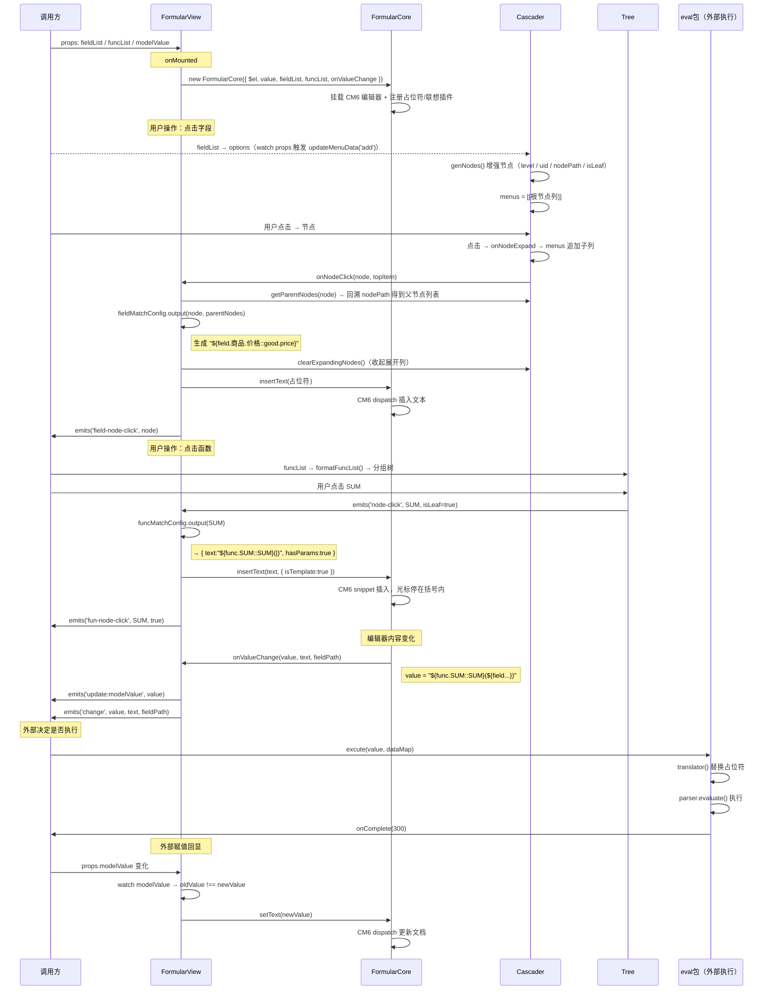

# formular-editor/view 详解

> `view` 包是整个公式编辑器系统**唯一对外暴露的 UI 组件**，把 `core`、`eval`、`func` 三个包的能力封装成一个 `<FormularView>` 组件，开箱即用。  
> 本包**不执行公式**，只负责生成结构化的公式字符串，执行交给外部调用方决定。

---

---

## UI 布局

```
┌──────────────────────────────────────────┐
│  输入区（editorRef）                       │
│  CodeMirror 编辑器挂载点                   │
│  [错误提示]  [检查语法]（showValidator=true）│
├──────────────────────────────────────────┤
│  运算符区                                  │
│  + - * / ( ) == != && || ...（可点击插入）  │
├──────────────────────────────────────────┤
│  工具区（varPanelRef）                     │
│  [字段Tab]  [函数Tab]  [其他字段Tab...]     │
│                                          │
│  字段Tab：Cascader 级联/折叠选择器         │
│  函数Tab：Tree 树形 + 函数详情面板          │
└──────────────────────────────────────────┘
```

---

## fieldList 与 funcList 的来源

这两个数据都是**调用方负责提供**的 props，`view` 包本身不产生数据。

### funcList

通常直接使用 `view` 包内置的 `FUNC_LIST_DEF`（70+ 条函数元数据），也可传入自定义子集：

```typescript
import FormularView, { FUNC_LIST_DEF } from '@ino/formular-editor-view'

const funcList = ref(FUNC_LIST_DEF)  // 直接使用内置定义
```

### fieldList（`IFieldData[]`）

按场景有三种来源：

| 场景 | 数据来源 | 处理方式 |
|------|---------|---------|
| 低代码编辑器（主场景）| `useFormularData()` 聚合后端 API + Pinia Store | 转换为多分组折叠树 |
| 属性面板过滤条件 | `apiGetModelFieldList(objectId)` + `useFormularData()` | 拼接"对象字段"分组 |
| 独立调试页 | 开发者手写 JS 对象 | `new Function` 直接执行 |

**`useFormularData()` 聚合的数据源：**

```
后端 API:
  业务对象字段（getDataModelList）
  全局变量（getGlobalVariable）
  系统变量（getSystemVariable）
  环境变量（getEnvVariable）

Pinia Store:
  页面变量（store.$variables）
  动作请求结果（store.$dataSource）
  组件暴露属性（store.getNodeExposedProps()）

    ↓ transformData() + genFormatData()

fieldList = [
  { label: '业务对象', fold: true, children: [...] },
  { label: '页面变量', fold: true, children: [...] },
  { label: '全局变量', fold: true, children: [...] },
  ...
]
```

---

## 三类插入行为

### 1. 点击运算符

```
点击 + / && / ( 等按钮
  → onInsertText(item)
  → _editorCore.insertText(text)
  → CM6 光标位置直接插入字符
```

### 2. 点击字段节点

```
点击"价格"节点（nodePath = ['goodList', 'price']）
  → cascaderRef.getParentNodes() 回溯父节点
  → emits('field-node-click')
  → fieldMatchConfig.output(node, parentNodes)
       → "${field.商品列表.价格::goodList.price}"
  → cascaderRef.clearExpandingNodes()（收起展开列）
  → _editorCore.insertText(占位符)
```

如果外部传了 `coreConfig.fieldMatchConfig` 但没有 `output`，则 return，控制权交给外部。

### 3. 点击函数节点

```
点击"SUM"（叶子节点）
  → emits('fun-node-click')
  → funcMatchConfig.output(data)
       有参数 → { text: "${func.SUM::SUM}(|)", hasParams: true }
       无参数 → { text: "${func.TODAY::TODAY}()", hasParams: false }
  → _editorCore.insertText(text, { isTemplate: hasParams })
       isTemplate=true → CM6 snippet，光标停在括号内
```

---

## 数据流时序图



---

## Cascader 级联组件关键机制

### 两种节点渲染模式

| 模式 | 触发条件 | 效果 |
|------|---------|------|
| 普通级联 | `fold = false`（默认）| 点击 `>` 向右展开新列，最多 3 列 |
| 折叠树 | `fold = true` | 节点内嵌展开/收起子级（适合多分组的变量列表）|

### menus 的列管理

```typescript
menus = [
  [ 商品Node, 客户Node ],       // 第一列（始终存在）
  [ 价格Node, 库存Node ],       // 第二列（展开商品后出现）
  [ 折扣Node ],                 // 第三列（展开价格后出现，最多到此）
]
// 收起时：menus = menus.slice(0, foldNums)
```

### 搜索过滤

`filterData(level, input)` 从 `allMenuData`（全量原始数据）深拷贝后递归过滤，自身或子节点匹配均保留。清空搜索框后自动恢复全量数据。

---

## formatFuncList：扁平转分组树

```
输入（扁平）:
  [{ alias:'SUM', groupAlias:'数组函数', desc:'...', usage:'SUM(list)', example:'...' }, ...]

输出（分组树）:
  [
    {
      label: '数组函数',
      children: [
        {
          ...SUM,
          label: 'SUM',
          _desc:    '<span>说明</span>: 计算数组中所有元素的和',
          _usage:   '<span>用法</span>: <span style="color:rgb(167,83,255)">SUM</span>(list)',
          _example: '<span>示例</span>: <span style="color:rgb(167,83,255)">SUM</span>([1,2,3]) 返回6',
        }
      ]
    },
    ...
  ]
```

函数名会被高亮为紫色，用 `v-html` 渲染在右侧详情面板。  
正则 `(^${alias})|[\s]+${alias}` 只匹配行首或前有空格的名字，防止把嵌套函数名误高亮。

---

## Vue 2/3 双版本兼容

| 差异点 | Vue 2 | Vue 3 |
|--------|-------|-------|
| v-model prop | `value` | `modelValue` |
| v-model event | `input` | `update:modelValue` |
| v-for ref | 收集为数组，按 index 取 | 函数形式，按 key 取 |
| 动态组件导入 | 注册为局部异步组件 | `shallowRef` + 动态 import |
| 响应式更新 | 需要 `= JSON.parse(JSON.stringify(...))` 触发 | 直接修改即可 |

构建时完全分离：`dist/`（Vue 3）和 `dist/v2/`（Vue 2）各输出一套。

---

## 对外 API 速览

### Props

| Prop | 说明 |
|------|------|
| `modelValue` / `value` | 公式字符串（v-model）|
| `fieldList` | 字段树数据 |
| `funcList` | 函数列表，不传则隐藏函数 Tab |
| `keywordList` | 运算符按钮，默认 17 个 |
| `coreConfig` | 自定义占位符规则（`fieldMatchConfig` / `funcMatchConfig`）|
| `fieldHeadTitle` | 将所有字段包在一个根 Tab 下 |
| `showValidator` | 是否显示"检查语法"区域 |
| `errorTip` | 语法错误提示文字 |
| `nodeTextConfig` | 自定义节点文字（非 slot 场景）|

### Emits

| 事件 | 触发时机 |
|------|---------|
| `change(value, text, fieldPath)` | 编辑器内容变化 |
| `update:modelValue(value)` | v-model 同步 |
| `field-node-click(node)` | 点击字段节点 |
| `fun-node-click(data, isLeaf)` | 点击函数节点 |
| `validate` | 点击"检查语法"按钮 |

### Expose

| 方法 | 说明 |
|------|------|
| `getEditorCore()` | 获取 `FormularCore` 实例 |
| `resize()` | 重新计算布局（窗口 resize 时调用）|

---

## 一句话总结

`view` 核心          ：

1. **工具区** → 用户点击生成占位符文本 → **insertText 进编辑器**
2. **编辑器内容变化** → onValueChange → **emit 出去给外部**
3. **外部决定是否执行** → 把公式字符串传给 `eval` 包 → **得到结果**