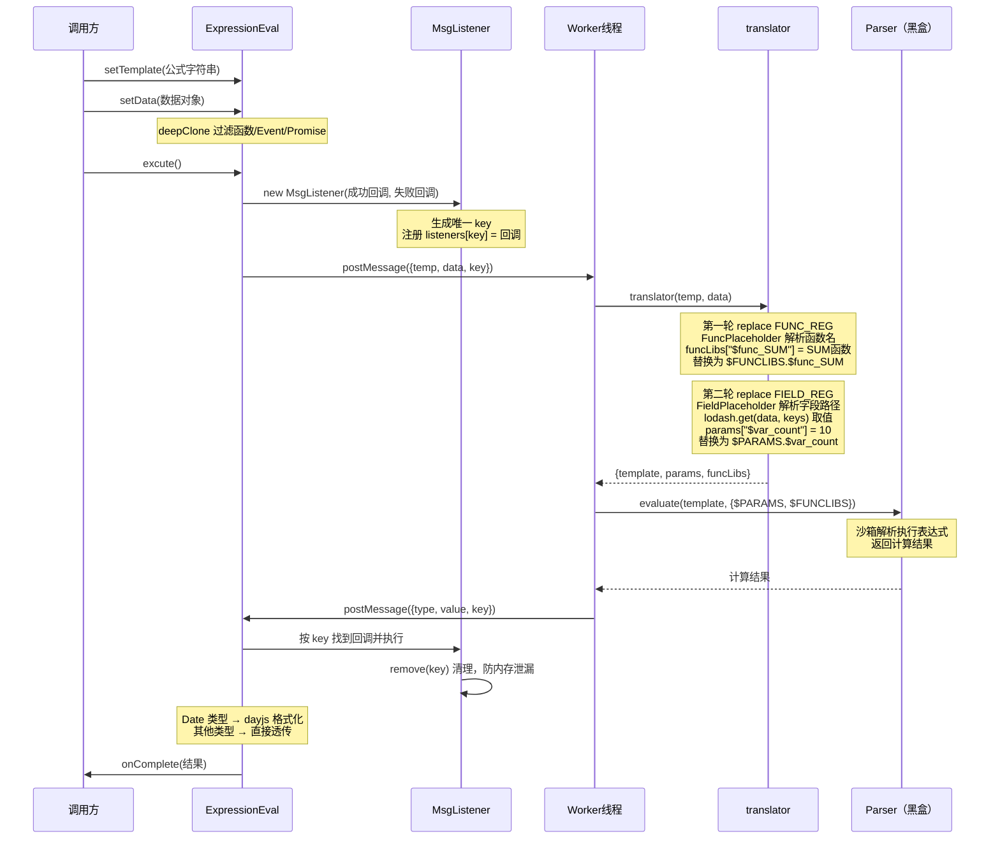

# formular-editor/eval 详解

> `eval` 包负责将公式模板字符串与上下文数据结合，计算出最终结果。  
> 核心能力是 **翻译占位符 → 沙箱执行**，全程在 WebWorker 线程中运行，不阻塞主线程 UI。

---

## 文件结构

```
eval/src/
├── index.ts              # 对外入口：ExpressionEval 类 + Worker 通信层
├── calculator/
│   ├── index.ts          # 核心逻辑：translator / calculator / parseTemplate
│   ├── worker.ts         # Worker 线程入口
│   └── fakeWorker.ts     # 降级方案，同步模拟 Worker 接口
├── expr-eval/            # 自研沙箱表达式解析器（本文视为黑盒，不展开）
└── util/
    ├── util.ts           # uuid、deepClone、typeOf、正则常量
    ├── numberPrecision.ts # 浮点数精确计算（加减乘除）
    └── index.ts          # 统一导出
```

---

## 执行流程概览



---

## Step 0：模块加载时，Worker 就已创建

```typescript
// index.ts 顶部，import 时立即执行
const calcWebWorker = new Worker(
  new URL('./calculator/worker', import.meta.url),
  { type: 'module' }
)
```

这是**全局单例**，所有 `ExpressionEval` 实例共用同一个 Worker 线程，靠 `key` 区分每次计算的回调。

---

## Step 1：`setTemplate` / `setData` 准备数据

### `setTemplate`

```typescript
setTemplate(temp: string) {
  this.temp = temp  // 直接存储，不做任何处理
  return this       // 支持链式调用
}
```

### `setData` — 深拷贝过滤

```typescript
setData(data: object) {
  this.data = this.useWebWorker ? cloneDeep(data) : data
}
```

使用 Worker 时必须深拷贝，原因：`postMessage` 内部使用**结构化克隆算法**，不支持函数、Event、Promise，遇到这些类型会直接报错。

`cloneDeep` 的处理策略（`util/util.ts`）：

```
原始数据对象
    ↓ lodash.cloneDeepWith
    遇到 函数 / Event / Promise → 替换为 ''（空字符串）
    其他类型 → 正常深拷贝
拷贝后的安全数据对象
```

不使用 Worker（`FakeWorker`）时，直接用原对象引用，无需拷贝。

---

## Step 2：`excute()` — 注册回调，发出消息

```typescript
excute(temp?, data?): void {
  if (temp) this.setTemplate(temp)
  if (data) this.setData(data)

  // 创建一次性监听器，自动生成唯一 key
  const _listener = new MsgListener(
    this._onMessage.bind(this),  // bind 锁定 this，防止回调时 this 丢失
    this._onError.bind(this),
    undefined,          // key 不传则自动 uuid(8) 生成
    this.useWebWorker
  )

  // 向 Worker 发消息，带上 key
  _listener.worker.postMessage({
    temp: this.temp,
    data: this.data,
    key:  _listener.key
  })
}
```

---

## Step 3：`MsgListener` — 回调路由表

`MsgListener` 是一个**静态注册表**，管理所有进行中的计算任务与回调的映射关系。

```typescript
class MsgListener {
  static ins:            { [key: string]: MsgListener } = {}  // 实例集合
  static listeners:      { [key: string]: IFunction } = {}    // 成功回调
  static errorListeners: { [key: string]: IFunction } = {}    // 失败回调
}
```

**注册流程（构造时）：**

```
new MsgListener(成功回调, 失败回调)
    ↓ key = uuid(8)，如 "aB3xZ9kL"
    ↓ MsgListener.ins["aB3xZ9kL"]           = 当前实例
    ↓ MsgListener.listeners["aB3xZ9kL"]     = 成功回调
    ↓ MsgListener.errorListeners["aB3xZ9kL"]= 失败回调
```

**清理流程（Worker 返回后）：**

```
MsgListener.remove("aB3xZ9kL")
    ↓ delete ins["aB3xZ9kL"]
    ↓ delete listeners["aB3xZ9kL"]
    ↓ delete errorListeners["aB3xZ9kL"]
```

并发多次计算时，每个任务有独立的 key，互不干扰。

---

## Step 4：Worker 线程接收消息

`calculator/worker.ts` 的 `onmessage` 触发：

```typescript
onmessage = (e) => {
  const { temp, data, key } = e.data

  let res
  let type = 1  // 1=成功，0=失败

  try {
    res = calculator(temp, data)
  } catch (error) {
    res = error  // 把错误对象回传，方便主线程展示
    type = 0
  }

  postMessage({ type, value: res, key })
}
```

---

## Step 5：`translator()` — 翻译占位符

这是整个系统最核心的函数，把模板字符串"翻译"成可执行表达式。

### 正则常量

```typescript
FUNC_REG  = /\$\{\s*(func\.\S+?)\s*\}/g   // 匹配 ${func.xxx::yyy}
FIELD_REG = /\$\{\s*(field\.\S+?)\s*\}/g  // 匹配 ${field.xxx::yyy}
```

`\S+?` 非贪婪，遇到第一个 `}` 停止，防止跨越多个占位符误匹配。

### `Placeholder` 基类 — 解析占位符结构

占位符格式：`类型.标签路径::值路径`

```
输入字符串："field.用户.地址::user.address"

_translate() 解析：
  ti  = 第一个 "." 位置 → type   = "field"
  lki = "::" 位置
  labels = slice(ti+1, lki).split('.') → ["用户", "地址"]  ← 人读的显示名
  keys   = slice(lki+2).split('.')     → ["user", "address"] ← 机器用的值路径
```

### 第一轮 replace：函数占位符 → funcLibs

```
匹配：${func.SUM::SUM}
  → FuncPlaceholder.getValue() = keys[0].toUpperCase() = "SUM"
  → FuncLibs["SUM"]（来自 @ino/formular-editor-func）
  → funcLibs["$func_SUM"] = SUM 函数实现
  → 替换为：$FUNCLIBS.$func_SUM
```

### 第二轮 replace：字段占位符 → params

```
匹配：${field.数量::count}
  → FieldPlaceholder.getValue(data)
  → lodash.get(data, ["count"]) = 10
  → （setTimeout 异步用 lodash.has 逐层校验路径，不存在则 console.error）
  → params["$var_count"] = 10
  → 替换为：$PARAMS.$var_count（两端加空格，防紧贴运算符报语法错误）

匹配：${field.折扣::discount}
  → params["$var_discount"] = 0.8
  → 替换为：$PARAMS.$var_discount
```

### 翻译结果

| 数据 | 内容 |
|------|------|
| `template` | `$PARAMS.$var_count * $FUNCLIBS.$func_SUM(1, $PARAMS.$var_discount)` |
| `params` | `{ "$var_count": 10, "$var_discount": 0.8 }` |
| `funcLibs` | `{ "$func_SUM": [Function: SUM] }` |

---

## Step 6：`parser.evaluate()` — 沙箱执行（黑盒）

```typescript
const parser = new Parser()
return parser.evaluate(template, {
  $PARAMS:   params,    // 字段值注入
  $FUNCLIBS: funcLibs   // 函数实现注入
})
```

`Parser` 是项目自研的沙箱表达式解析器（位于 `expr-eval/` 目录），不依赖任何第三方解析库。

- 接收表达式字符串和变量上下文
- 沙箱隔离，无法访问 `window`、`document` 等全局对象
- 执行 `$FUNCLIBS.$func_SUM(1, 0.8) * $PARAMS.$var_count` → 返回 `18`

---

## Step 7：Worker 将结果回传主线程

```typescript
postMessage({ type: 1, value: 18, key: "aB3xZ9kL" })
```

主线程 `onmessage`（在 `createWorker` 中挂载）：

```typescript
computerWorker.onmessage = (ev) => {
  const success = ev.data?.type === 1
  const listeners = success ? MsgListener.listeners : MsgListener.errorListeners

  Object.keys(listeners).forEach((key) => {
    if (ev.data?.key === key) {
      listeners[key](ev.data?.value)  // 执行对应回调
      MsgListener.remove(key)          // 立即清理
    }
  })
}
```

---

## Step 8：`_onMessage()` — 结果后处理

```typescript
private _onMessage(result: any) {
  if (typeOf(result) === 'date') {
    // Date 对象经 postMessage 序列化后需重新格式化
    this.onComplete(dayjs(result).format('YYYY-MM-DD'))
  } else {
    this.onComplete(result)
  }
}
```

`typeOf` 用 `Object.prototype.toString` 精确判断类型：
- `"[object Number]"` → `"number"`
- `"[object Date]"` → `"date"`

---

## Step 9：用户收到最终结果

```typescript
evalEngine.onComplete(18)  // 用户定义的回调被触发
```

---

## 数据转换总览

```
输入公式字符串
"${field.数量::count} * ${func.SUM::SUM}(1, ${field.折扣::discount})"
    │
    │ setData → deepClone（过滤不可序列化类型）
    │
    ↓ translator 第一轮（FUNC_REG）
"${func.SUM::SUM}"  →  funcLibs["$func_SUM"] = SUM函数
    ↓ 占位符替换为 $FUNCLIBS.$func_SUM
    │
    ↓ translator 第二轮（FIELD_REG）
"${field.数量::count}"    →  params["$var_count"] = 10
"${field.折扣::discount}" →  params["$var_discount"] = 0.8
    ↓ 占位符替换为 $PARAMS.xxx
    │
    ↓ parser.evaluate（黑盒沙箱执行）
template = "$PARAMS.$var_count * $FUNCLIBS.$func_SUM(1, $PARAMS.$var_discount)"
    ↓ 注入 $PARAMS 和 $FUNCLIBS
    ↓ 计算 SUM(1, 0.8) * 10
    │
    ↓ _onMessage 后处理
    数字/字符串 → 直接透传
    Date 类型   → dayjs.format('YYYY-MM-DD')
    │
    ↓
最终结果：18
```

---

## 降级方案：`FakeWorker`

不支持 Worker，或主动传入 `useWebWorker=false` 时启用。

```
真 Worker：  postMessage → [异步等待] → onmessage（异步）
FakeWorker：postMessage → 立即计算   → 立即 onmessage（同步）
```】、

两者接口完全相同，上层代码（`MsgListener`）无需任何修改。

---

## 静态工具：`parseTemplate()`

不计算结果，只提取公式中引用了哪些字段路径：

```typescript
ExpressionEval.getFieldsPath(
  "${field.数量::count} + ${field.折扣::discount}",
  "_"   // 路径分隔符，默认 "_"
)
// → ["count", "discount"]
```

常用于监听字段变化、按需触发重新计算。
