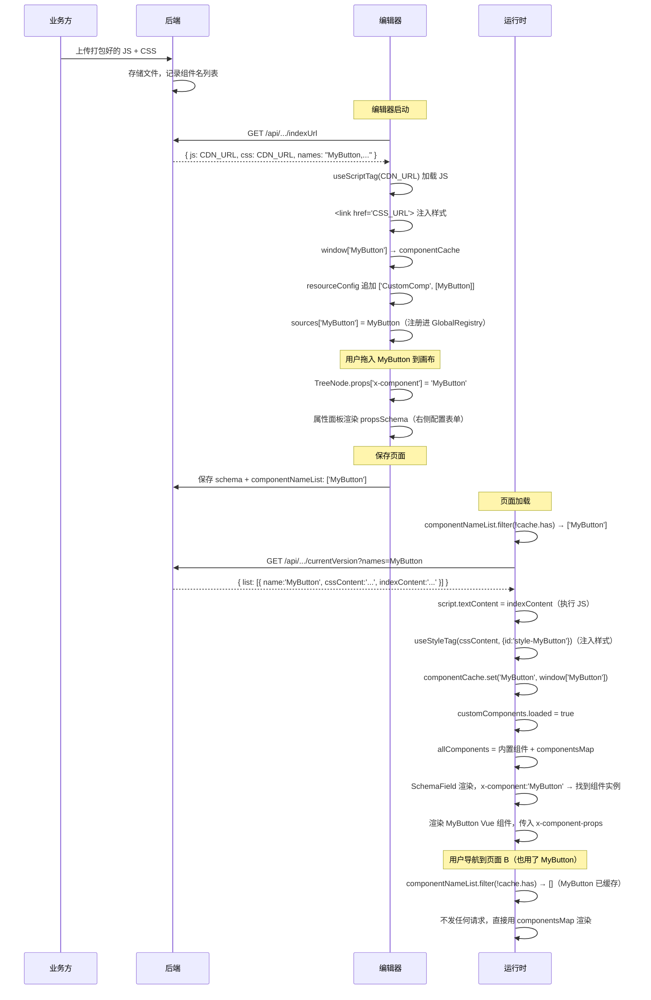

# 远程自定义组件动态加载机制详解

> 本项目支持业务方将自己开发的 Vue 组件上传到后端，编辑器和运行时在需要时动态加载、注册、渲染，无需修改前端代码重新发布。

---

## 整体流程概览

```
业务方开发 Vue 组件
    ↓ 打包为 UMD/IIFE 格式，暴露到 window[name]
    ↓ 上传 JS + CSS 到后端存储

编辑器启动
    ↓ 请求 /api/view-component/components/indexUrl
    ↓ 获得 JS/CSS 的 CDN 地址
    ↓ 动态加载脚本和样式
    ↓ 从 window[name] 取出组件构造函数
    ↓ 追加到物料面板 CustomComp 分组
    ↓ 用户拖入画布 → schema 中写入 x-component: 'MyComp'

运行时渲染页面
    ↓ 解析 schema.componentNameList（页面用到的自定义组件名列表）
    ↓ 请求 /api/view-component/components/currentVersion
    ↓ 按组件名按需加载，注入 script + style
    ↓ componentCache.set(name, window[name])
    ↓ allComponents = 内置组件 + 自定义组件
    ↓ SchemaField 渲染时按 x-component 找到对应组件实例
```

---

## 一、组件的打包规范（业务方需遵守）

业务方开发的 Vue 组件，需要打包为**UMD 或 IIFE 格式**，并将自身挂载到全局 `window` 对象上。

```javascript
// 打包后的组件自动执行：
window['MyCustomButton'] = {
  name: 'MyCustomButton',
  props: { /* ... */ },
  setup() { /* ... */ },
  // ...
}
```

构建配置示例（vite）：

```typescript
// vite.config.ts
export default {
  build: {
    lib: {
      entry: 'src/index.ts',
      name: 'MyCustomButton',    // ← window 上挂载的 key
      formats: ['umd'],
      fileName: 'index',
    },
    rollupOptions: {
      external: ['vue'],          // vue 不打入包，由宿主环境提供
      output: {
        globals: { vue: 'Vue' }
      }
    }
  }
}
```

同时需要提供一个 CSS 文件（可以为空）。

---

## 二、编辑器侧：加载流程

### 2.1 后端 API 接口（编辑器）

```
GET /api/view-component/components/indexUrl?status=1&editorType=1
```

返回结构：

```json
{
  "cssFilePath": "custom-comps/v1/index.css",
  "indexFilePath": "custom-comps/v1/index.js",
  "names": "MyButton,MyTable",
  "disableNames": "MyOldComp"
}
```

| 字段 | 说明 |
|------|------|
| `cssFilePath` | CSS 文件在文件服务器上的相对路径 |
| `indexFilePath` | JS 文件相对路径（所有自定义组件合并打包进一个文件）|
| `names` | 当前启用的组件名列表（逗号分隔）|
| `disableNames` | 已停用的组件名列表（加载但不展示在物料面板）|

`getCustomCompList()` 处理后返回：

```typescript
{
  css:  '/files/custom-comps/v1/index.css',
  js:   '/files/custom-comps/v1/index.js',
  names: ['MyButton', 'MyTable', 'MyOldComp'],  // 全量名单
  disableNames: ['MyOldComp'],                   // 停用名单
  allNames: ['MyButton', 'MyTable', 'MyOldComp'],
}
```

### 2.2 加载脚本与样式（`useRemoteComponents`）

编辑器用 `@vueuse/core` 的 `useScriptTag` 加载远程 JS（URL 形式），CSS 通过创建 `<link>` 标签注入：

```typescript
// 样式：动态创建 <link>
const link = document.createElement('link')
link.rel = 'stylesheet'
link.href = cssFilePath   // CDN URL
document.head.appendChild(link)

// 脚本：useScriptTag（自动去重，相同 URL 只加载一次）
const { load } = useScriptTag(indexFilePath, () => {}, { async: true })
await load()

// 脚本执行后，组件已挂到 window 上
const constructor = componentCache.has(name)
  ? componentCache.get(name)   // 命中缓存直接取
  : (window as any)[name]      // 首次取全局变量

// 存入本地缓存 Map
componentCache.set(name, constructor)
```

### 2.3 追加到物料面板（`useComponentConfig`）

加载完成后，动态追加一个 `CustomComp` 分组到 `resourceConfig`：

```typescript
// 原始物料配置
resourceConfig = [
  ['Layouts', [FlowLayout, Loop, ...]],
  ['Inputs',  [Input, TextArea, ...]],
  // ...
]

// 加载完自定义组件后，追加一组
resourceConfig = [
  ...原始配置,
  ['CustomComp', [MyButton, MyTable]]  // ← 动态追加
]
```

同时把组件追加到 `sources`（组件名 → 组件实体的映射），注册进 GlobalRegistry，设计时画布就能找到它：

```typescript
sources = {
  Button: ButtonVueComponent,
  Input: InputVueComponent,
  // ...内置组件
  MyButton: MyButtonRemoteComponent,  // ← 追加
  MyTable: MyTableRemoteComponent,
}
```

---

## 三、运行时侧：按需加载

运行时与编辑器侧的加载策略不同：**编辑器侧一次性全量加载**（因为需要展示所有可用组件），**运行时按需加载**（只加载当前页面实际使用的组件，减少网络请求）。

### 3.1 schema 中记录组件使用列表

页面 schema 里有一个 `componentNameList` 字段，记录了这张页面用到了哪些自定义组件名：

```json
{
  "form": { "x-component-props": { ... } },
  "schema": { "properties": { ... } },
  "componentNameList": ["MyButton", "MyTable"]  // ← 只有用到的自定义组件
}
```

这个列表在编辑器保存时自动生成（通过遍历所有 TreeNode 的 `x-component` 字段比对 `$allComponentNameList` 得出）。

### 3.2 后端 API 接口（运行时）

```
GET /api/view-component/components/currentVersion?names=MyButton,MyTable&versions=0,0
```

返回结构：

```json
{
  "list": [
    {
      "name": "MyButton",
      "cssContent": ".my-button { color: red; }",  // CSS 字符串（直接内联）
      "indexContent": "var MyButton = (function(...){...})()"  // JS 字符串
    },
    {
      "name": "MyTable",
      "cssContent": "...",
      "indexContent": "..."
    }
  ]
}
```

注意：运行时接口返回的是**内容字符串**，而非 URL。这样运行时不需要额外的 CDN 请求。

### 3.3 注入脚本与样式（运行时 `useRemoteComponents`）

```typescript
// CSS：用 useStyleTag（vueuse）注入，id 去重
const { load: loadStyle } = useStyleTag(cssContent, {
  immediate: false,
  id: `style-${name}`    // 相同 id 不重复注入
})
loadStyle()

// JS：创建 script 标签，把代码字符串作为内容执行
const script = document.createElement('script')
script.textContent = indexContent  // 直接内联代码
document.body.appendChild(script)  // 执行（挂载到 window）
document.body.removeChild(script)  // 执行完立即移除（不保留标签）

// 执行后从 window 取出
const constructor = (window as any)[name]
componentCache.set(name, constructor)
```

### 3.4 等待加载完成再渲染（`runtime-core/index.vue`）

`customComponents.loaded` 是一个 `ref<boolean>`，在加载完成前，页面渲染被阻塞：

```html
<!-- 必须等自定义组件加载完（loaded = true）才渲染 -->
<InoConfigProvider v-else-if="store.$userConfigs.__loaded && customComponents.loaded.value">
  <FormProvider :form="form">
    <SchemaField :schema="pageSchema" :components="allComponents" />
  </FormProvider>
</InoConfigProvider>
```

`allComponents` 是内置组件和自定义组件的合并：

```typescript
const allComponents = computed(() => ({
  ...props.components,                     // 内置组件（runtime-components）
  ...customComponents.componentsMap.value, // 自定义组件（动态加载的）
}))
```

`onMounted` 时按顺序执行：

```typescript
onMounted(async () => {
  startInitLoading()                      // 开始 loading
  await loadPageLogics(...)               // 1. 加载逻辑脚本
  await customComponents.reload()         // 2. 加载自定义组件
  await store.initUserConfigs()           // 3. 初始化用户配置
  finishInitLoading()                     // 结束 loading，渲染页面
})
```

---

## 四、组件缓存机制

### 4.1 缓存对象的定义位置与生命周期

两侧的缓存对象定义位置不同，生命周期也不同：

**编辑器侧（`playground/editor/src/hooks/useCompConfig.ts`）：**

```typescript
// 模块顶层声明 —— JS 模块级单例
const componentCache = new Map<string, any>()
```

- 随 JS bundle 加载时创建，跟随整个编辑器会话存活
- 刷新页面才会销毁，没有主动清理机制
- 作用域：当前标签页的编辑器实例

**运行时侧（`designable/runtime-core/src/hooks/useRemoteComponents.ts`）：**

```typescript
// 通过 window.getPageStore() 获取 Pinia store 上的 Map
const getComponentCache = () => window.getPageStore().componentCache
```

`componentCache` 定义在全局 Pinia store（`global.ts`）的 state 里：

```typescript
// playground/runtime/src/stores/modules/global.ts
state: (): IPageStoreState => ({
  componentCache: new Map<string, any>(),   // ← 跨页面共享的缓存
  // ...
})

// store 通过 window.getPageStore 暴露全局访问入口
window.getPageStore = () => useAppStore()
```

- `window.getPageStore()` 始终返回同一个 store 实例
- SPA 内页面导航（路由切换）**不会清除**，同一组件在不同页面间共用一份缓存
- 刷新浏览器才会销毁（Pinia 不做持久化）

---

### 4.2 缓存查找与写入逻辑

两侧都遵循相同的「先查缓存，未命中再去 window 取」模式：

```typescript
// Step 1：优先从缓存取（已注册过的直接返回）
const constructor = componentCache.has(name)
  ? componentCache.get(name)    // 缓存命中 → 直接复用
  : (window as any)[name]       // 缓存未命中 → 脚本执行后组件挂在 window 上

// Step 2：首次加载成功后写入缓存
if (!componentCache.has(name)) {
  componentCache.set(name, constructor)
}
```

**为什么先查缓存再查 window？**

JS 脚本执行后会把组件挂到 `window[name]`，但 `window` 是全局单一对象。如果同名组件被多次加载（比如切换到新版本后再切回来），`window[name]` 可能指向新版本实例，而缓存里保留的是当前会话第一次加载的版本。通过缓存优先，保证同一会话内渲染的始终是同一份组件实例，避免版本不一致导致的渲染异常。

---

### 4.3 网络请求层的缓存过滤（仅运行时）

运行时在**发出网络请求之前**就过滤掉已缓存的组件，实现真正的「按需请求」：

```typescript
// useCustomComponents.ts
const reload = async () => {
  // 从 schema 的组件名单里，过滤掉已在 cache 中的
  const noCachedComponentNameList = props.schema.componentNameList?.filter(
    (name: any) => !appStore.componentCache.has(name)
  )

  if (noCachedComponentNameList?.length) {
    loading.value = true
    // 只请求没有缓存的组件
    const list = await getCustomCompList(noCachedComponentNameList)
    assetList.value = list
    await loadAll()
  }
  // 如果全部命中缓存 → noCachedComponentNameList 为空 → 不发任何请求
}
```

**典型场景：**

```
页面 A 加载：componentNameList = ['MyButton', 'MyTable']
  → noCachedList = ['MyButton', 'MyTable']（缓存为空）
  → 请求后端，加载，写入缓存

页面 B 加载：componentNameList = ['MyButton', 'MyForm']
  → noCachedList = ['MyForm']（MyButton 已在缓存，跳过）
  → 只请求 MyForm，不重复加载 MyButton
```

编辑器侧没有这个过滤步骤，因为启动时只请求一次全量列表，不存在重复请求场景。

---

### 4.4 CSS 与 JS 的资源层去重机制

除了组件构造函数的缓存，CSS 和 JS 的加载本身也有各自的去重手段：

| 资源 | 编辑器侧 | 运行时侧 |
|------|---------|---------|
| **CSS** | 直接创建 `<link href="URL">` 标签，无去重（可能重复注入）| `useStyleTag(cssContent, { id: 'style-${name}' })`，相同 id 只注入一次 |
| **JS** | `useScriptTag(url)` —— vueuse 内部用 URL 去重，相同 URL 不重复请求 | `script.textContent = code` 内联执行，无 URL 机制，但依赖缓存过滤（未命中缓存才执行）|

运行时的 CSS 方案更安全：`useStyleTag` 用 `id` 唯一标识，即使多个弹窗/抽屉/页面容器并发加载同一个组件，CSS 也只注入一份 `<style>` 标签。

---

### 4.5 `componentsMap` 响应式计算属性

缓存写入后，运行时通过一个 computed 属性把 cache 暴露为响应式对象，供上层合并进 `allComponents`：

```typescript
// useRemoteComponents.ts
const componentsMap = computed(() => ({
  ...Object.fromEntries(componentCache),  // Map → 普通对象
  ...listToMap(components.value),         // 本次加载结果（shallowRef）
}))
```

- `componentCache` 是 Map，`Object.fromEntries` 将其展开为 `{ MyButton: VueComp, ... }`
- 每次 `loadAll()` 执行后更新 `components.value`（shallowRef 触发重计算）
- 上层的 `allComponents` 依赖此 computed，自动响应更新：

```typescript
// runtime-core/index.vue
const allComponents = computed(() => ({
  ...props.components,                      // 内置组件（静态）
  ...customComponents.componentsMap.value,  // 自定义组件（响应式）
}))
```

---

### 4.6 编辑器侧的 `isDisabled` 标记

编辑器加载完成后，会给停用的组件打上 `isDisabled = true`：

```typescript
compNames.forEach((name) => {
  const constructor = componentCache.has(name)
    ? componentCache.get(name)
    : (window as any)[name]

  constructor.isDisabled = disableNames.includes(name)  // ← 打标记
  componentCache.set(name, constructor)
})

// 物料面板渲染时过滤掉停用组件
resourceConfig.value = [
  ...RESOURCE_CONFIG,
  ['CustomComp', components.value.filter(comp => !comp.isDisabled)]
]
```

停用的组件**仍然被加载和缓存**（因为已存在于页面中的实例还需要能正常渲染），只是不再出现在物料面板，用户无法拖入新的。

---

### 4.7 缓存机制全景图

```
┌──────────────────────────────────────────────────────────────┐
│                         编辑器侧                              │
│                                                              │
│  componentCache（JS 模块级 Map，随 bundle 生命周期）           │
│                                                              │
│  加载时：                                                     │
│    componentCache.has(name)?                                 │
│      是 → 直接复用，不重新加载                                │
│      否 → useScriptTag(url) 加载 → window[name] → 写入缓存   │
│                                                              │
│  物料面板：                                                   │
│    缓存里的组件追加到 resourceConfig['CustomComp']            │
│    isDisabled=true 的不展示但仍缓存                           │
└──────────────────────────────────────────────────────────────┘

┌──────────────────────────────────────────────────────────────┐
│                         运行时侧                              │
│                                                              │
│  appStore.componentCache（Pinia store Map，SPA 内跨页面共享） │
│                                                              │
│  请求前：                                                     │
│    componentNameList.filter(name => !cache.has(name))        │
│    → 只请求未缓存的组件（可能一个都不请求）                    │
│                                                              │
│  加载时：                                                     │
│    cache.has(name)?                                          │
│      是 → 直接进入 componentsMap                             │
│      否 → script.textContent 执行 → window[name] → 写入缓存  │
│                                                              │
│  渲染时：                                                     │
│    componentsMap = Object.fromEntries(cache) + 本次加载结果   │
│    allComponents = 内置组件 + componentsMap                   │
│    SchemaField 按 x-component 查找 allComponents 渲染         │
└──────────────────────────────────────────────────────────────┘
```

---

## 五、编辑器 vs 运行时加载差异对比

| 对比项 | 编辑器 | 运行时 |
|--------|--------|--------|
| 接口 | `/api/.../indexUrl` | `/api/.../currentVersion` |
| 返回格式 | URL（CDN 地址）| 代码字符串（直接内联）|
| 加载策略 | 全量（所有启用的自定义组件）| 按需（只加载当前页面用到的）|
| CSS 注入 | `<link href="...">` 标签 | `useStyleTag(cssContent)` 内联 |
| JS 注入 | `useScriptTag(url)` 远程加载 | `script.textContent = code` 内联执行 |
| 挂载目标 | `window[name]` | `window[name]` |
| 缓存对象 | 模块级 `Map`（随 bundle 存活）| Pinia store `Map`（SPA 内跨页共享）|
| 缓存过滤 | 无（全量加载，无需过滤）| 请求前过滤已缓存组件名 |
| CSS 去重 | 无（可能重复注入 `<link>`）| `useStyleTag` id 去重 |
| JS 去重 | `useScriptTag` URL 去重 | 缓存前置过滤防止重复执行 |

---

## 六、完整数据流时序图



---

## 七、一句话总结各阶段职责

| 阶段 | 做了什么 |
|------|---------|
| 业务方打包 | 把组件挂到 `window[name]`，提供 JS + CSS |
| 后端存储 | 保存文件，记录组件名单，提供 URL 或内容查询接口 |
| 编辑器加载 | 全量加载 → 注册到物料面板和 GlobalRegistry |
| 保存页面 | schema 记录 `componentNameList` 备运行时使用 |
| 运行时加载 | 缓存过滤 → 按需请求 → 合并进 `allComponents` |
| 页面渲染 | SchemaField 按 `x-component` 从 `allComponents` 取组件渲染 |
